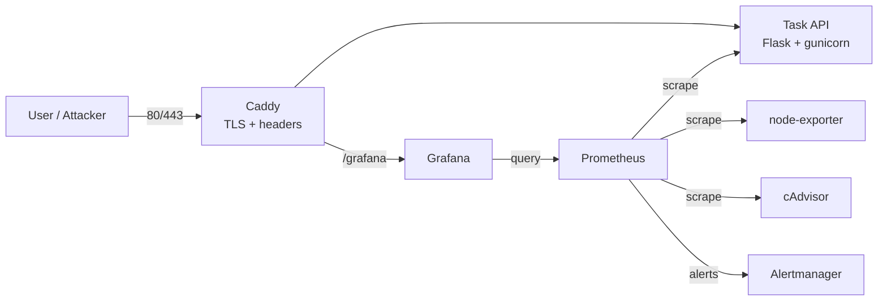
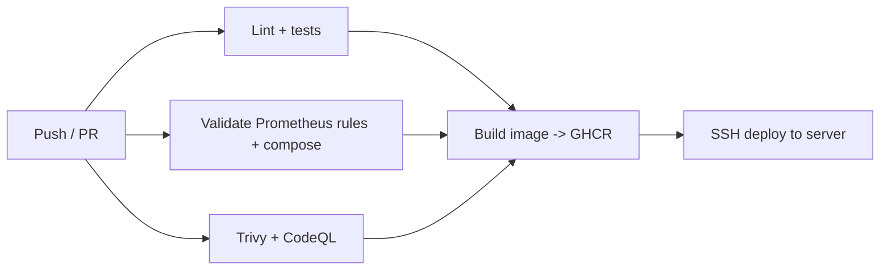

# SecOps Observability Platform

[](https://github.com/mukesh-soc/secops-observability/actions/workflows/ci.yml)
[](https://github.com/mukesh-soc/secops-observability/actions/workflows/codeql.yml)


A DevSecOps project: a containerized API with full observability, security alerting, and a CI/CD pipeline that scans, builds, publishes and deploys it.

It answers two questions in real time: **"Is my service healthy?"** and **"Is someone attacking it?"**


## Architecture



## Pipeline



## Features
| Area | What it does |
|---|---|
| Metrics | Request rate, p95 latency, 5xx ratio, failed logins, host CPU, container memory |
| Alerts | `ServiceDown`, `HighErrorRate`, `HighLatencyP95`, **`PossibleBruteForce`** |
| Provisioning | Grafana data source and dashboard load automatically (no clicking) |
| Hardening | Non-root, read-only FS, no capabilities, `no-new-privileges`, security headers, `/metrics` blocked publicly |
| Supply chain | Pinned versions, Trivy image/fs scans, CodeQL, Dependabot |
| Delivery | Automatic HTTPS (Caddy + Let's Encrypt), CI/CD with SSH deploy |

## Quick start (local)
```bash
git clone https://github.com/mukesh-soc/secops-observability.git
cd secops-observability
cp .env.example .env        # set passwords
make up
make load                   # traffic + simulated brute-force attack
```
- API: http://localhost/
- Grafana: http://localhost/grafana/  (dashboard: **SecOps -> SecOps Overview**)
- Prometheus: http://localhost:9090 (localhost only)
- Alertmanager: http://localhost:9093 (localhost only)

## Deploy to a server
On a fresh Ubuntu VM (free-tier Oracle/AWS works):
```bash
DOMAIN=monitor.example.com bash <(curl -fsSL https://raw.githubusercontent.com/mukesh-soc/secops-observability/main/scripts/bootstrap-vm.sh)
```
This installs Docker, opens only SSH/80/443, generates random passwords, and starts the stack. Omit `DOMAIN` to serve plain HTTP on the server IP.

### Continuous deployment
In the repo: **Settings -> Secrets and variables -> Actions**
- Secrets: `SSH_HOST`, `SSH_USER`, `SSH_KEY` (private key of a deploy user)
- Variable: `DEPLOY_ENABLED` = `true`

Every green push to `main` then updates the server automatically.

## Demo: detecting a brute-force attack
1. `make load` sends repeated bad logins to `/login`.
2. `auth_failures_total` climbs; the **Failed logins** panel spikes.
3. After ~1 min, `PossibleBruteForce` fires in Prometheus (**Alerts**) and Alertmanager.

## Repository layout
```
app/            Flask API, Dockerfile (non-root)
prometheus/     scrape config + alert rules
alertmanager/   routing
grafana/        provisioned datasource + dashboard JSON
caddy/          reverse proxy / TLS
scripts/        load generator, VM bootstrap
.github/        CI, CodeQL, Dependabot
examples/       the original Prometheus + Grafana lab-manual stack
```

## Roadmap
- Real Slack/email alert receiver
- Loki + Promtail for log-based security detections
- Kubernetes manifests / Helm chart
- Rate limiting on `/login`

## License
MIT
